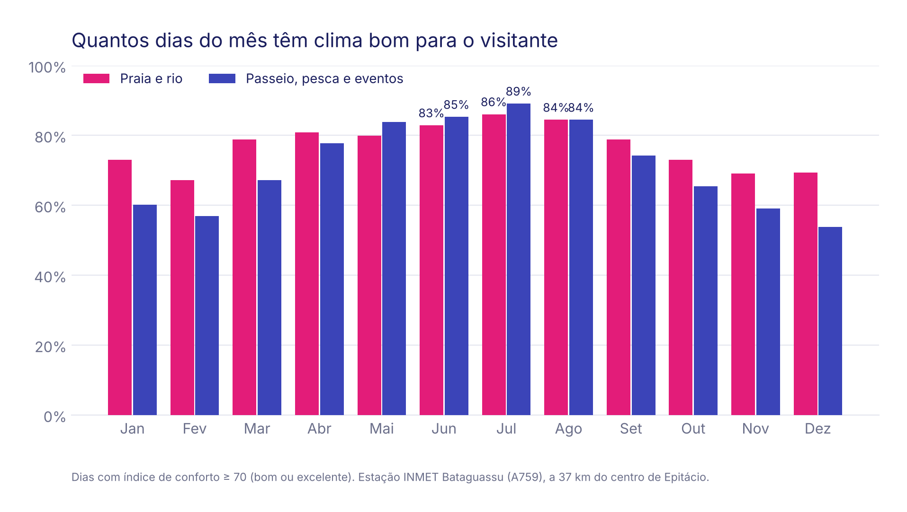
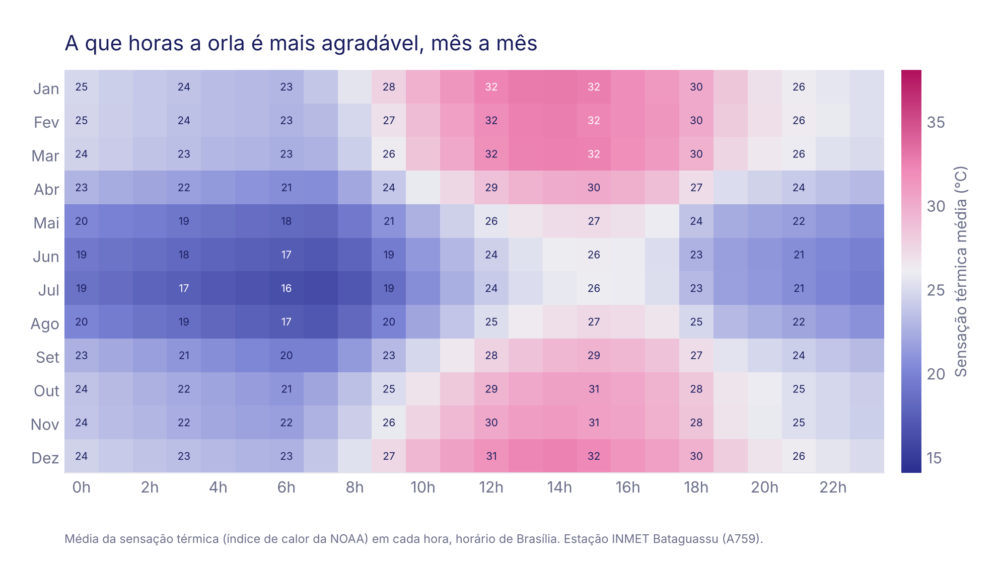
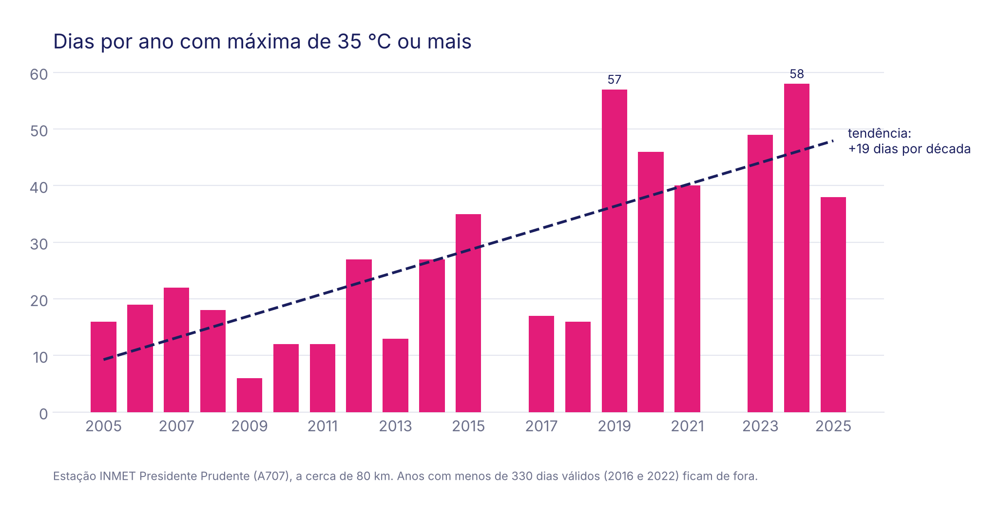

# Quando visitar Presidente Epitácio?

**Um calendário climático para o turismo na estância do Rio Paraná, feito com 23 anos de dados do INMET.**



## A pergunta

Presidente Epitácio (SP) vive do turismo de rio: orla, praias, pesca e passeios de barco. Mas qual é a melhor época para visitar? E, num dia de verão, a que horas vale a pena ir para a orla?

A resposta muda conforme o visitante. Por isso o projeto avalia o clima para dois perfis:

- **Praia e rio:** quem vem para nadar e curtir as praias;
- **Passeio, pesca e eventos:** quem vem para a orla, pescar, passear de barco ou ir a eventos.

## Principais descobertas

1. **De maio a agosto é a melhor época para visitar.** De 84% a 89% dos dias desses meses têm clima bom ou excelente para passeio, pesca e eventos, e de 80% a 86% para praia e rio. É a estação seca, com máximas médias de 27 a 29 °C.
2. **Para praia e rio, o ano é mais equilibrado** (de 67% a 86% de dias bons). O verão perde pontos pelo calor excessivo e pela chuva. Abril e setembro são um bom meio-termo para quem quer entrar na água.
3. **No verão, o horário faz diferença.** De dezembro a março, a sensação térmica passa de 30 °C das 11h às 19h. A orla fica mais agradável até as 9h e depois das 20h.
4. **O calor extremo está ficando mais comum.** Em Presidente Prudente, os dias com máxima de 35 °C ou mais passaram de 16 por ano (2005 a 2013) para 48 por ano (2019 a 2025).

| | |
|---|---|
|  |  |

## Dados

Presidente Epitácio não tem estação meteorológica do INMET. O projeto usa as duas mais próximas:

| Estação | Código | Distância | Período | Uso |
|---|---|---|---|---|
| Bataguassu (MS) | A759 | cerca de 37 km, do outro lado do rio | 2013 a 2025 | calendário turístico e horários |
| Presidente Prudente (SP) | A707 | cerca de 80 km | 2003 a 2025 | tendência de calor |

As máximas diárias das duas estações têm correlação de 0,95, o que indica um clima regional homogêneo.

**Limpeza:** leituras `-9999` e valores fisicamente impossíveis viram ausentes; um dia só entra na análise se tiver pelo menos 20 das 24 horas registradas; anos com menos de 330 dias válidos ficam fora da tendência; horários convertidos de UTC para o horário de Brasília.

## Método: um índice de conforto para o turista

Cada dia recebe uma nota de 0 a 100, numa adaptação do **Holiday Climate Index: Beach** (Scott, Rutty, Amelung e Tang, 2016):

```
índice = 2 × conforto térmico + 4 × céu aberto + 3 × chuva + 1 × vento     (cada nota de 0 a 10)
```

- **Conforto térmico:** sensação térmica máxima do dia (índice de calor da NOAA). O ideal é de 28 a 33 °C para praia e de 22 a 28 °C para passeio.
- **Céu aberto:** radiação solar do dia comparada com um dia limpo do mesmo mês. Substitui a cobertura de nuvens do índice original, que o INMET não mede.
- **Chuva** e **vento:** faixas que penalizam dias chuvosos e de vento forte no rio.

Dias com nota 70 ou mais são considerados bons. Dias sem medição completa ficam fora das porcentagens. As regras estão em [`src/indice_turismo.py`](src/indice_turismo.py).

## Limitações

- A estação fica a 37 km da cidade. A orla, ao lado da água, pode ser um pouco mais amena e úmida.
- Não há dados de temperatura da água nem de nível do rio, que importam para quem vai nadar. Os dados de nível do Rio Paraná da ANA são um próximo passo natural.
- As faixas de cada nota são escolhas do projeto, inspiradas no índice original.
- Entre 12% e 24% dos dias de cada mês não têm medição completa e ficam fora das porcentagens. Até a versão anterior, eles contavam como dias "não bons", o que baixava os números (principalmente no verão).
- Bataguassu tem falhas entre 2019 e 2022 (2021 sem dados). Treze anos mostram o padrão sazonal, mas não substituem normais climatológicas de 30 anos.

## Estrutura

```
clima-turismo-epitacio/
├── analise.ipynb            # análise completa, passo a passo
├── src/
│   ├── baixar_dados.py      # baixa os .zip anuais do INMET e extrai as duas estações
│   ├── processar.py         # limpeza e agregação diária
│   ├── indice_turismo.py    # índice de conforto para os dois perfis
│   └── graficos.py          # gráficos na identidade visual do portfólio
├── dados/processados/diario.csv
└── figuras/
```

## Como reproduzir

```bash
pip install -r ../requirements.txt
python src/baixar_dados.py 2003 2025   # cerca de 2,5 GB de download, guarda só ~30 MB
python src/processar.py
python src/exportar_web.py              # resumo em JSON para a página do portfólio
jupyter notebook analise.ipynb
```

**Ferramentas:** Python, pandas, NumPy, Matplotlib e Jupyter.
**Fonte:** [INMET, Dados Históricos](https://portal.inmet.gov.br/dadoshistoricos).
